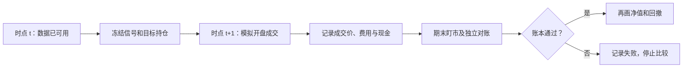

# 回测流程图示例

把信号和成交拆成不同节点。不画出这条时间边界，回测很难从图上审查是否用了未来数据。GitHub 支持用 [Mermaid 源码](https://docs.github.com/en/get-started/writing-on-github/working-with-advanced-formatting/creating-diagrams)渲染如下流程。

对应 [合成订单账本](../project/synthetic-backtest-comparison/README.md)；图不是交易引擎。
