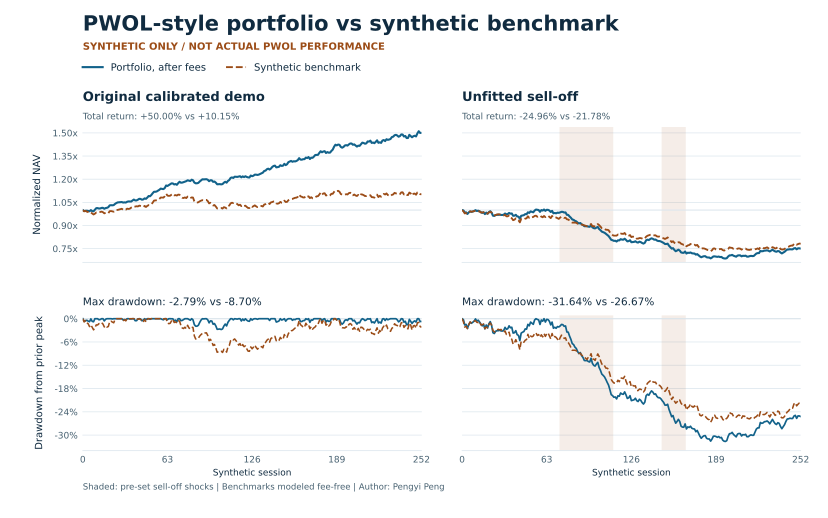

# 合成基准和未校准下跌压力

**作者：Pengyi Peng｜时间：2026-11-22T16:54:18+08:00（Asia/Shanghai）**

这项实验保留[前一版校准组合](../pwol-synthetic-demo/README.md)的逐期净值，新增同一期次的合成基准；再用另一个种子与提前固定的两段下跌冲击，重跑同一个组合权重与费用规则。**不使用实际 PWOL 持仓、行情或业绩。压力结果没有按收益、Sharpe 或回撤反求参数。**



[指标矩阵与结果解读](../../report/2026-11-22-pwol-benchmark-and-stress.md) · [完整摘要](artifacts/summary.json) · [逐期系列](artifacts/comparison-series.json) · [复跑哈希](artifacts/receipt.json)

## 复现

从仓库根目录运行。回测和测试需 Python 3.12，绘图需 [固定依赖](../../pdrawer/requirements.txt)（这里使用 Matplotlib 3.11.2）。以下本地输出目录应尚不存在。

```bash
python -B -m unittest discover -s tests -v
python -B -m pbacktest.pwol_benchmark_stress --output .local/pwol-benchmark-replay
python -m pip install -r pdrawer/requirements.txt
python -B -m pdrawer.benchmark --run .local/pwol-benchmark-replay --output .local/pwol-comparison
```

[protocol.json](protocol.json)给出原夹具 SHA-256、种子、无风险利率、基准参数与压力窗口。运行生成合成数字，不下载行情或连接券商，也不触发交易。压力版两段阴影分别是第 73–112、149–166 期；每列画风险时各自从其历史峰值算回撤，两列使用相同刻度。来自不同版本/系统的绘图字节可能不同。
