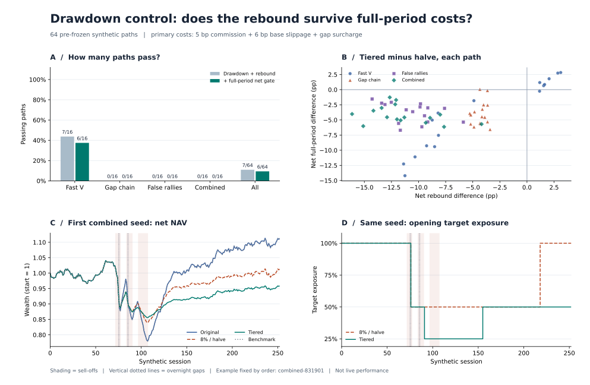

# PWOL 多种子合成压力与 SQL 对账

**作者：Pengyi Peng｜时间：2026-11-22T17:28:24+08:00（Asia/Shanghai）**

相同的三个组合版本和每条路径的共同基准，跑四类各 16 条合成路径、两档滑点。只用合成数据和虚拟行业，无行情与实盘接口。冻结时间是 `2026-11-22T17:23:08+08:00`；协议还锁定了上一轮策略文件哈希。



[完整报告](../../report/2026-11-22-pwol-drawdown-batch.md) · [冻结协议](protocol.json) · [汇总](artifacts/summary.json) · [逐种子结果](artifacts/paths.json) · [板块与行业](artifacts/attribution.json) · [代表路径序列](artifacts/example.json) · [复跑回执](artifacts/receipt.json)

## Python 复现与 SQL 练习

从仓库根目录运行。Python 3.12 标准库可跑实验、单测和 SQLite；只有画图需要 Matplotlib。用未出现过的输出路径。

```bash
python -B -m unittest discover -s tests -v
python -B -m pbacktest.pwol_drawdown_batch --output .local/batch-replay --keep-db
python -B scripts/query_drawdown_batch.py .local/batch-replay/ledger.sqlite
python -m pip install -r pdrawer/requirements.txt
python -B -m pdrawer.drawdown_batch --run .local/batch-replay --output .local/batch-figure
```

不带 `--keep-db` 时用内存 SQLite，仍执行全部对账。带参数会在本地生成约 48 MB 的纯合成数据库，不进 Git。版本库保留了[表和视图](ledger.sql)及[三个查询](practice.sql)：先复算一条路径并核对 MDD、期末收益与换手，再按相同 seed/window 配对板块和行业，最后查滑点最高的开盘成交。可把自己写的只读查询文件通过 `--sql` 传进去；基准实际每条路径只回放一次，数据库为两档成本的匹配连接复用了同一份基准结果。

口述顺序：**先冻结 → Python 事件账本 → SQL 对账 → 同基准费后比较 → 用短窗过线但全期失败的反例解释决策。**
