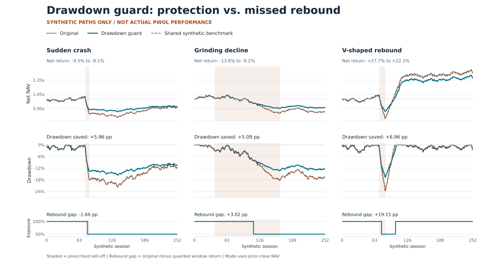

# 三条合成路径上的回撤降仓

**作者：Pengyi Peng｜结果记录：2026-11-22T17:03:39+08:00（Asia/Shanghai）**

回撤降仓用同一账本对照原版、降仓版与共同基准。三条路径在运行前固定，不反求收益、Sharpe 或回撤；只用合成数据，不是真实 PWOL 持仓或业绩。



**规则：**仅用降仓版自身的已知收盘 NAV 和截至该收盘的高水位；回撤达 8%，下一期开盘将目标仓位降到 50%；满 5 个已完成降仓期且回撤收窄至 4% 以内，下一期开盘恢复。仓位在非调仓非切换日自然漂移。固定的冲击与跌后观察窗只在生成和评分使用，未传给规则。

[完整结果、行业讨论和指标表](../../report/2026-11-22-pwol-drawdown-guard.md) · [规则、资产和路径](protocol.json) · [指标与信号/成交时点](artifacts/summary.json) · [逐期序列](artifacts/series.json) · [板块/行业归因](artifacts/attribution.json) · [复跑凭据](artifacts/receipt.json)

## 复现

从仓库根目录使用 Python 3.12；仅绘图依赖 Matplotlib。输出选择尚不存在的目录或前缀：

```bash
python -B -m unittest discover -s tests -v
python -B -m pbacktest.pwol_drawdown_guard --output .local/guard-run
python -m pip install -r pdrawer/requirements.txt
python -B -m pdrawer.drawdown_guard --run .local/guard-run --output .local/guard-comparison
```

数据、归因和 summary 三次落盘哈希一致；同环境两次 SVG 相同。跨平台允许浮点和字体的正常差异。不安装绘图库也能独立复跑回测、指标和单测。
