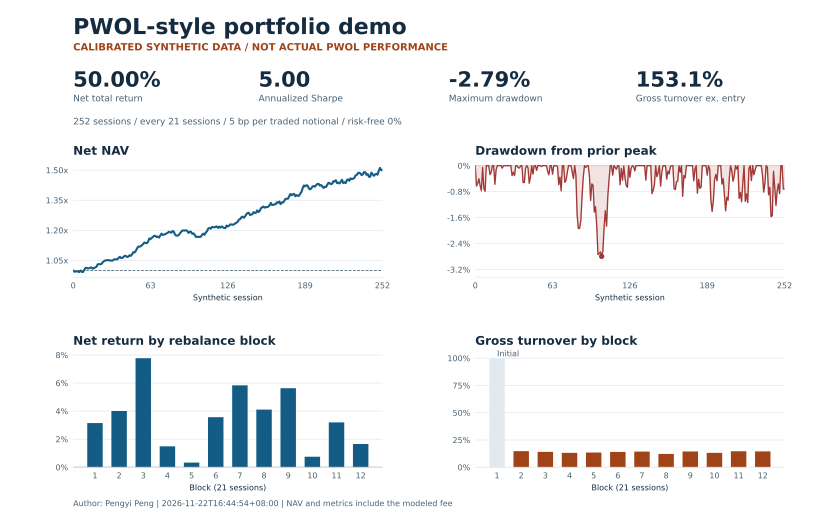

# PWOL 风格合成组合演示

**作者：Pengyi Peng｜结果记录：2026-11-22T16:48:16+08:00（Asia/Shanghai）**  
**数据：主动校准的合成夹具，不是实际 PWOL 组合、业绩或投资证据。**

这组输入用于把 [pbacktest](../../pbacktest/README.md)、[pevluation](../../pevluation/README.md) 和 [pdrawer](../../pdrawer/README.md) 串起来。两只虚拟资产，252 个期次，每 21 期调仓（约月频），每笔按成交金额计 5 个基点费用。合成路径用全期信息调出 **费后总收益 50.00% 和年化 Sharpe 5.00**；最大回撤 **−2.79%**、费用和换手是同一账本算出来的，不是另设目标。



[指标与口径](../../pevluation/README.md) · [摘要](artifacts/summary.json) · [逐期序列](artifacts/series.json) · [24 笔模拟成交](artifacts/fills.json) · [选型与复盘说明](../../report/2026-11-22-pwol-synthetic-portfolio.md)

续篇：[合成基准和未校准下跌压力](../pwol-benchmark-stress/README.md)。此处的原始逐期净值与产物未改。

## 复现

在仓库根目录用 Python 3.12。绘图需安装已固定的 Matplotlib；回测与测试用标准库。下面给新的本地目录，避免覆盖现有快照。

```bash
python -B -m unittest discover -s tests -v
python -B -m pbacktest.pwol_demo --output .local/pwol-run
python -m pip install -r pdrawer/requirements.txt
python -B -m pdrawer.dashboard --run .local/pwol-run --output .local/pwol-dashboard
```

[固定夹具](fixture.json)含种子、调仓权重、费用、目标以及 6% 的示意回撤上限；上限只验收，未参与拟合。两次独立进程及归档运行的摘要、逐期和成交文件字节相同；相同版本两次 SVG 生成字节相同。不同平台的字体与数值不承诺等字节。[产物哈希](artifacts/receipt.json)
