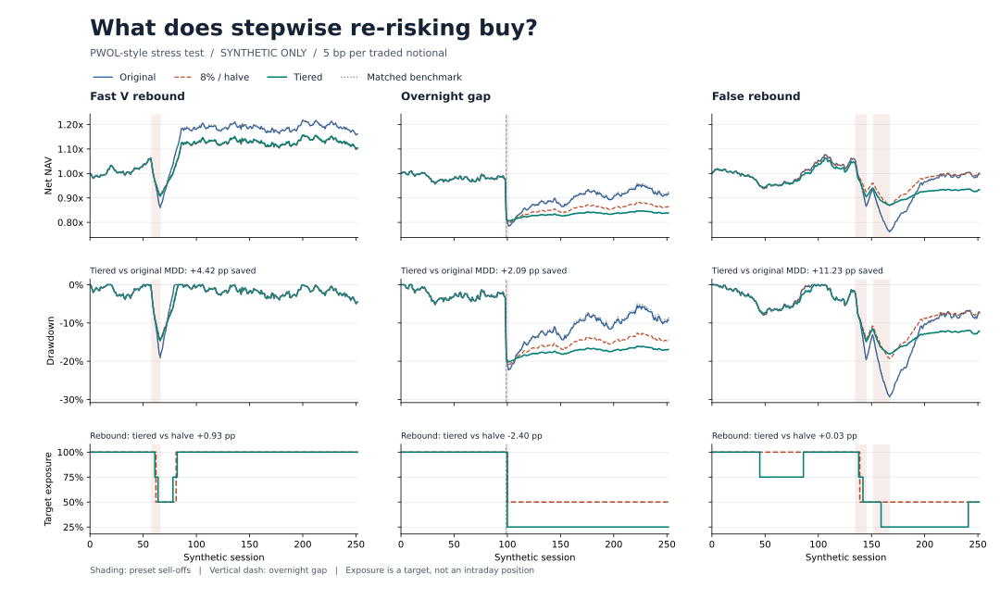

# PWOL 分档降仓与分步恢复

**作者：Pengyi Peng｜记录时间：2026-11-22T17:16:25+08:00（Asia/Shanghai）｜仅合成**

在新 V 形、跳空、假反弹三条未拟合路径上，比较原版、8% 砍半版、分档版和共同基准；主要费率 5 bp，预置敏感性 15 bp。窗口、种子、信号和门槛先写入协议。没有行情、持仓或实盘接口。



[完整报告](../../report/2026-11-22-pwol-tiered-drawdown.md) · [冻结协议](protocol.json) · [净指标与成交时点](artifacts/summary.json) · [画图序列](artifacts/series.json) · [板块与行业对账](artifacts/attribution.json) · [复跑凭据](artifacts/receipt.json)

## 复现

从仓库根目录运行（Python 3.12，回测和测试只用标准库）。输出选未使用的目录或前缀。

```bash
python -B -m unittest discover -s tests -v
python -B -m pbacktest.pwol_tiered_drawdown --output .local/tier-replay
python -m pip install -r pdrawer/requirements.txt
python -B -m pdrawer.tiered_drawdown --run .local/tier-replay --output .local/tier-figure
```

`summary.json` 内有冻结协议的文件字节哈希与每条路径的输入哈希；`series.json` 只供制图，净值和回撤保留 8 位小数，指标从未截断的账本计算。已验证同环境两次回测和 SVG 完全一致；跨平台字体或浮点末位可能不同。
