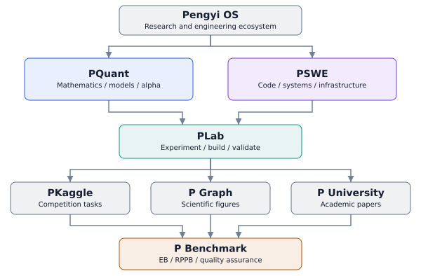
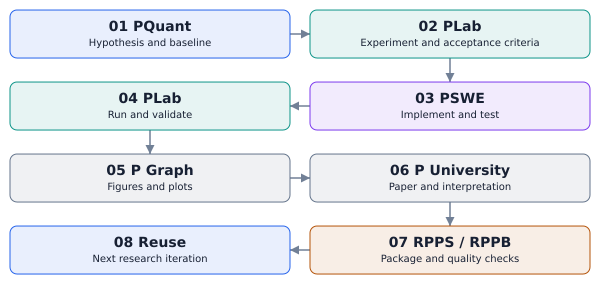

# An Integrated Quantitative Research and Software Engineering Ecosystem

**Author:** Pengyi Peng | **Date:** 2026-11-28 04:24 (UTC+8) | **Version:** 1.0 (Working Paper)

## Abstract
We propose an integrated architecture connecting quantitative research (PQuant), software engineering (PSWE), and experimental validation (PLab). The framework specifies division of responsibilities, engineering handoffs, candidate joint projects, and publication quality controls. It links scientific visualization and academic writing to a versioned Research Paper Package (RPP). This is a conceptual working paper; empirical and integration claims remain untested.

## 1. Introduction
Quantitative research and software engineering are complementary capabilities. PQuant owns hypotheses, mathematics, statistical inference and investment models; PSWE owns implementation, architecture, correctness, reliability and performance. PLab provides a shared experimental environment. The objective is to translate research into reliable, reusable artifacts rather than duplicate engineering across projects.

## 2. Integrated architecture
Figure 1 illustrates the proposed organizational architecture. PQuant and PSWE form the two core capability domains. PLab defines experiments, acceptance criteria and evidence. PKaggle supplies competition tasks; P Graph produces scientific visualizations; P University formalizes research. P Benchmark evaluates execution and package quality through EB and RPPB.

**Figure 1:** Integrated quantitative research and software engineering ecosystem.

## 3. Software engineering capability map
PSWE covers programming (Python, C++, Rust, Go), algorithms and data structures, architecture and system design, data engineering, distributed systems, HPC (GPU, CUDA, Triton), AI infrastructure, agent engineering, testing and reliability, databases, research engineering, scientific computing and security. Research engineering connects mathematical modeling with repeatable computation.

## 4. Joint operating protocol
Figure 2 depicts the handoff. PQuant specifies the hypothesis, baseline, data and metric; PLab defines the experiment and acceptance criteria; PSWE implements code, tests, configuration and infrastructure; PLab runs the experiment and records results and failures; P Graph creates figures; P University writes the paper; RPPS packages the artifacts and RPPB evaluates release readiness. Each handoff records owner, inputs, outputs, source commit and evidence. Failed experiments return to the relevant research or engineering owner.

**Figure 2:** Joint research-to-engineering operating protocol.

## 5. Candidate projects
Candidate joint projects include alpha research and backtesting, financial ML training and inference, portfolio optimization and risk, FICC pricing and market data, agent evaluation and harnesses, RPP production automation, scientific figure generation, and Kaggle experiment management. A first pilot should be a small, public-data alpha or Kaggle experiment with a tested baseline and reproducible configuration. The projects are proposed, not completed.

## 6. Evaluation and limitations
Evaluate research by out-of-sample validity, robustness, uncertainty and risk; evaluate software by correctness, test evidence, reliability and performance; evaluate the laboratory by reproducibility, controlled comparisons and traceable results. Apply RPPS and RPPB to the final package. No empirical performance, completed system integration, production deployment or automated cross-repository orchestration is claimed. Access, licensing and data confidentiality must be checked before reuse.

## 7. Conclusion
The proposed ecosystem connects four mutually reinforcing loops: research (hypothesis to evidence), engineering (code to tested reusable system), experimentation (experiment to result to improvement), and publication (research to paper to package to reuse). Its success should be demonstrated through actual joint projects and verifiable artifacts.

## Internal references
- RPPS: https://github.com/pengpengyi92/PKAGGLE/blob/main/mldlrl/reports/research-paper-package-standard.md
- RPPB: https://github.com/pengpengyi92/PBenchmark/tree/main/benchmarks/rppb
